**Cloud and AI engineer** at [GoodAI Labs](https://goodailabs.com) &nbsp;·&nbsp; India

[**codenickk.com**](https://codenickk.com) &nbsp;·&nbsp;
[apps](https://apps.codenickk.com) &nbsp;·&nbsp;
[linkedin](https://linkedin.com/in/nikhilsingh08) &nbsp;·&nbsp;
[x](https://x.com/itsyournickkk) &nbsp;·&nbsp;
[mail](mailto:0nikhilsingh5@gmail.com)

I started out on cloud infra and now build AI products on top of it. Right now that's live voice
calls with AI agents, the chat people use to talk to them, and the sign-in and hosting under both.
I still like my infra boring enough that the rest of the team forgets it's there.

---

## 01 · AI work

[GoodAI Labs](https://goodailabs.com) is an AI research lab. The code is private, so this is the
public side of what I work on.

  &nbsp;
  

#### Colony &nbsp;→&nbsp; [colony.goodailabs.com](https://colony.goodailabs.com)

A personal AI agent that keeps its memory, tools and jobs from one chat to the next, and works on a
computer you control. My part is the live voice calls. You talk to your agent, ask for something
mid-call, and it tells you when the work is done. I also work on the chat in the browser, and on
sign-in and hosting on AWS.

Rust · Python · Pipecat · OpenAI Realtime · Gemini Live · React · TypeScript · Cognito · S3 · CloudFront

#### Reflex-1 &nbsp;→&nbsp; [huggingface.co/gai-labs/reflex-1](https://huggingface.co/gai-labs/reflex-1)

A small 421M model that picks one answer from a list: which tool to call, what someone wants, which
move to make next. It runs fast on a plain CPU, and the weights are open. I made the Doom and
Chrome Dino demos on the [launch post](https://goodailabs.com/blog/reflex-1-fast-decisions/), where
it plays both games live.

Python · PyTorch · Hugging Face · ViZDoom

---

## 02 · On the side

#### Shramik &nbsp;→&nbsp; [shramik.codenickk.com](https://shramik.codenickk.com)

Android app that registers informal workers in India and tracks who gets placed where. The whole
thing runs at ₹0 a month, and the workers' data never leaves India.

Kotlin · Supabase Postgres in ap-south-1 · app repo private, the public form is open: [`shramik-form`](https://github.com/0NikhilSingh5/shramik-form)

#### fuelmeter &nbsp;→&nbsp; [apps.codenickk.com/fuel](https://apps.codenickk.com/fuel/)

A fuel log for one person. Log your fills and watch mileage and cost per km over time. It works
with no signal at the pump, and every reading stays in your browser.

React 19 · TypeScript · Vite · service worker · repo private

#### codenickk.com &nbsp;→&nbsp; [live](https://codenickk.com)

The Cloud Resume Challenge, finished and still running. The site and every app under it sit on S3
and CloudFront, with two small Python Lambdas for the visitor counter and the contact form.

Next.js static export · S3 · CloudFront functions · Lambda · API Gateway · source: [`aws-cloud-resume`](https://github.com/0NikhilSingh5/aws-cloud-resume)

---

## 03 · Stack

AI: Pipecat · OpenAI Realtime · Gemini Live · PyTorch · Hugging Face

---

## 04 · Signals

---

## 05 · Shelf

Older things, still public and still working.

- [`serverless-eSSL-attendance-tracker`](https://github.com/0NikhilSingh5/serverless-eSSL-attendance-tracker): biometric attendance off the eSSL API. Lambda, API Gateway, S3.
- [`acumatica_automated_build_publish`](https://github.com/0NikhilSingh5/acumatica_automated_build_publish): Jenkins pipeline that builds and publishes Acumatica ERP customisations, with rollback.
- [`aws-rds-optimizer`](https://github.com/0NikhilSingh5/aws-rds-optimizer): a CPU alarm fires, a Lambda flips on `slow_query_log` and finds who did it.
- [`iis-config-manager`](https://github.com/0NikhilSingh5/iis-config-manager): PowerShell GUI for auditing and hardening `web.config` across IIS sites.
- [`second-price-auction-bidder`](https://github.com/0NikhilSingh5/second-price-auction-bidder): ML bidding system for second-price ad auctions.
- [`Useful-Scripts`](https://github.com/0NikhilSingh5/Useful-Scripts): Bash and PowerShell odds and ends that automate the boring parts.

---

## 06 · Connect

 

Cloud and AI engineer by day, gamer by night.

